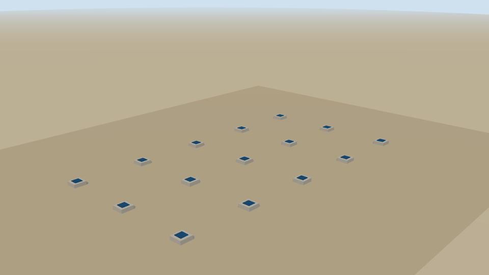

# Casino modular para obra – Modelo 3D

**HABYTEC SAS · Modelo conceptual interactivo**

Tres alternativas de casino sobre el módulo 3x6: A 9x12 a dos aguas, B 6x12 a dos aguas y C 6x12 a una agua.

Vistas: terminado, secuencia de armado en 7 pasos y despiece. Incluye la tabla de piezas con su peso y cuántas personas mueven cada una. Se arma sin grúa, con máximo 4 personas.

Modelo conceptual, no apto para construcción. © HABYTEC SAS
